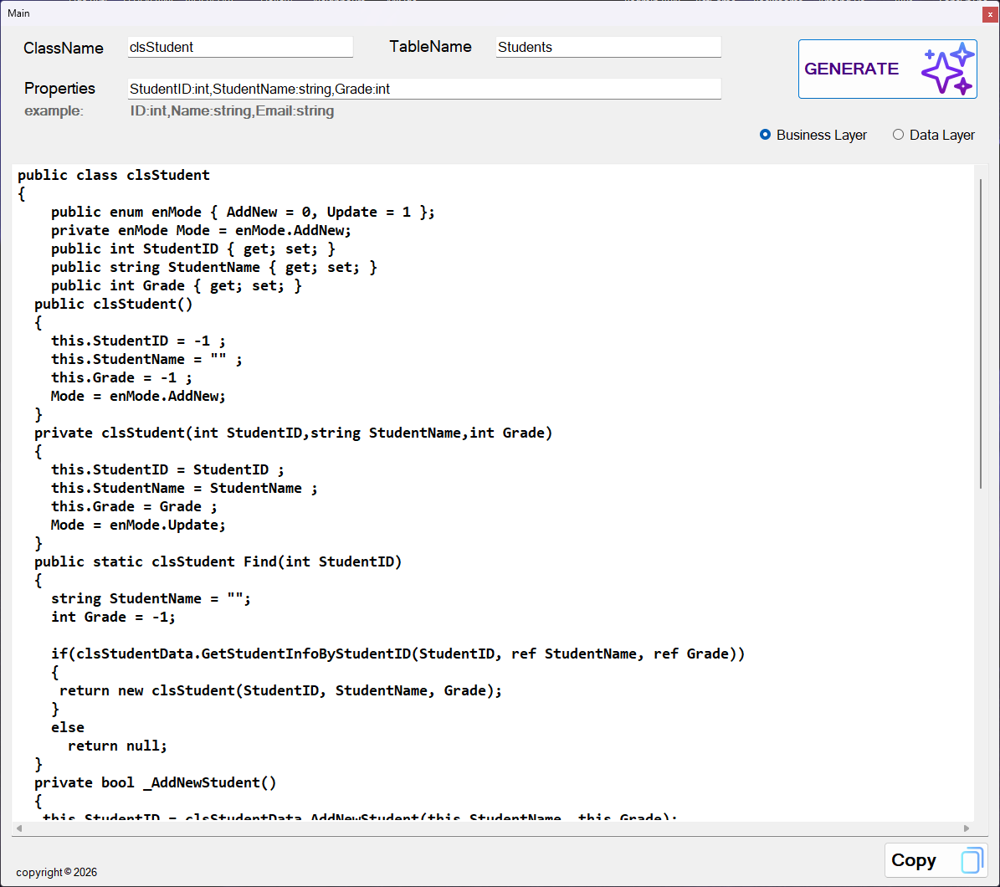

# Simple Code Generator

A desktop application built with C# and WinForms that automatically generates Business Layer and Data Access Layer code from user-defined class information.

## Features

- Generate Business Layer classes.
- Generate Data Access Layer classes.
- Generate CRUD methods automatically.
- Create code from a simple class definition.
- Copy generated code with one click.
- Clean and easy-to-use interface.

## Technologies Used

- C#
- Windows Forms
- .NET Framework

## How It Works

Enter:

- Class Name
- Database Table Name
- Class Properties

Example:

```text
StudentID:int,StudentName:string,Grade:int
```

Choose:

- Business Layer
- Data Layer

Click **Generate** and the application will generate the required code automatically.

## Screenshot



## Example Input

```text
Class Name: clsStudent
Table Name: Students

Properties:
StudentID:int,
StudentName:string,
Grade:int
```

## Generated Output

The application can generate:

- Properties
- Constructors
- CRUD Methods
- Business Layer Classes
- Data Access Layer Classes

## Why I Built This Project

While developing database applications, I noticed that writing DAL and BLL classes repeatedly takes a lot of time. This project automates the process and helps speed up development.

## What I Learned

Through this project I practiced:

- String Processing
- Code Generation Techniques
- WinForms Development
- Object-Oriented Programming
- Layered Architecture Design
- C# Best Practices

## Future Improvements

- Generate code directly from SQL Server tables.
- Export generated code to .cs files.
- Support Entity Framework.
- Support Stored Procedures generation.
- Generate Presentation Layer templates.

## Author

**Monees Mohammed**

GitHub: https://github.com/MoneesMohammed
